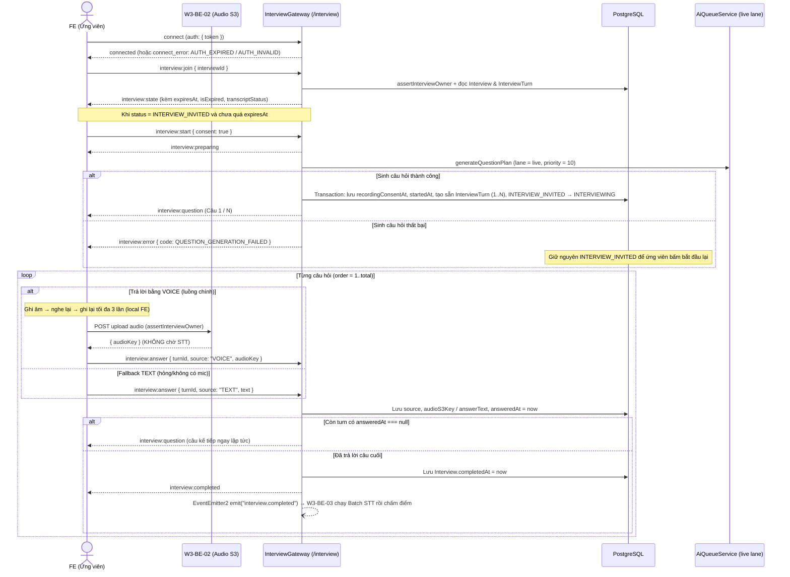

# Đặc tả Sự kiện Phỏng vấn Real-time (`InterviewGateway` — W3-BE-01)

Tài liệu thống nhất giao thức Socket.IO cho phiên phỏng vấn AI giữa **BE (Huy)**, **FE (Minh)** và **AI (Tài)**. Toàn bộ trạng thái phiên được lưu trong PostgreSQL (`interviews`, `interview_turns`) nên ứng viên có thể ngắt kết nối và vào lại bất cứ lúc nào để tiếp tục đúng câu đang dở.

> **Quy tắc chung của phiên phỏng vấn:**
>
> - **Luồng chính (`VOICE`):** Trong phiên, ứng viên đọc câu hỏi → ghi âm → nghe lại → có thể ghi lại tối đa **3 lần** trên trình duyệt → bấm Gửi → upload audio lên S3 (`W3-BE-02`) → chuyển ngay sang câu tiếp theo. **Không** chạy STT giữa phiên và **không** hiện/sửa transcript trong lúc phỏng vấn. Hết phiên hệ thống mới chạy STT hàng loạt rồi AI chấm điểm (`W3-BE-03`).
> - **Fallback (`TEXT`):** Khi máy ứng viên hỏng/không có micro, cho phép chuyển sang gõ văn bản (bỏ qua upload audio, gửi thẳng `text`).
> - **Hạn chót (`expiresAt`):** Mỗi phiên `Interview` có thời hạn hoàn thành (`Interview.expiresAt`, mặc định +7 ngày kể từ lúc HR duyệt vòng CV). Quá hạn mà chưa hoàn thành (`completedAt === null`) sẽ bị từ chối thao tác (`INTERVIEW_EXPIRED`).
> - **Ngoài phạm vi (không làm):** giới hạn thời gian đếm ngược mỗi câu, nút Skip, nhiều người cùng xem một phiên, khóa toàn màn hình / quét tiến trình máy.

---

## 1. Kết nối & Xác thực

- **Giao thức:** Socket.IO
- **Namespace:** `/interview`
- **Path:** `/socket.io` (FE kết nối cùng domain: dev đi qua Vite proxy, production đi qua Caddy; BE vẫn cấu hình CORS theo `FRONTEND_ORIGIN` để dự phòng).
- **Xác thực:** gửi JWT access token qua `handshake.auth.token` (xác thực bằng `TokenService.verifyAccessToken`).

```ts
import { io } from 'socket.io-client';

const socket = io('/interview', {
  path: '/socket.io',
  auth: { token: accessToken },
});
```

### Lỗi xác thực ở bước Handshake (`connect_error`)

Khi token thiếu, sai hoặc hết hạn, server từ chối kết nối ngay tại middleware handshake. FE bắt lỗi trong `socket.on('connect_error', (err) => ...)` theo `err.message` (và `err.data?.code`):

| `code` (`err.message`) | Nguyên nhân                                                         | Hành động gợi ý cho FE                                                                                                      |
|:-----------------------|:--------------------------------------------------------------------|:----------------------------------------------------------------------------------------------------------------------------|
| `AUTH_EXPIRED`         | Access token đã hết hạn (`TokenExpiredError`).                      | Gọi `POST /api/auth/refresh` lấy access token mới, cập nhật `socket.auth = { token: newToken }` rồi gọi `socket.connect()`. |
| `AUTH_INVALID`         | Thiếu token, token sai định dạng/chữ ký, hoặc payload không hợp lệ. | Xóa phiên đăng nhập và chuyển về `/login`.                                                                                  |

### Quy tắc sở hữu & Reconnect

- Chỉ tài khoản **`CANDIDATE`** sở hữu hồ sơ (`application.candidateId === user.id`) mới được phép vào phiên (`assertInterviewOwner`).
- Mỗi lần kết nối thành công (bao gồm cả **sau khi reconnect**), FE **bắt buộc** gửi lại `interview:join { interviewId }` vì `socket.data` trên server chỉ tồn tại theo vòng đời từng kết nối socket.

---

## 2. Sơ đồ luồng sự kiện



---

## 3. Events Client → Server

### `interview:join`

Tham gia phiên phỏng vấn (dùng cho cả lần vào đầu tiên và mỗi lần reconnect).

```json
{
  "interviewId": "550e8400-e29b-41d4-a716-446655440000"
}
```

- **Kiểm tra:** `interviewId` là UUID hợp lệ, tồn tại, thuộc quyền sở hữu của ứng viên đang kết nối.
- **Kết quả:** lưu `interviewId` vào `socket.data` và gửi về sự kiện `interview:state` (kể cả khi phiên đã quá hạn hoặc đã hoàn thành để FE hiển thị đúng màn hình tương ứng).

---

### `interview:start`

Bắt đầu buổi phỏng vấn sau khi ứng viên đồng ý ghi âm.

```json
{
  "consent": true
}
```

- **Điều kiện:**
  - Socket đã `interview:join`.
  - Phiên chưa quá hạn `expiresAt` (nếu quá hạn → `INTERVIEW_EXPIRED`).
  - `consent` phải là `true` (nếu không → `CONSENT_REQUIRED`).
  - Trạng thái hồ sơ phải là `INTERVIEW_INVITED` và không đang bị gọi trùng song song (nếu khác → `INVALID_STATE`).
- **Xử lý:**
  1. Khóa in-flight theo `interviewId` (chống bấm trùng 2 lần liên tiếp).
  2. Gửi ngay `interview:preparing` để FE hiện trạng thái đang chuẩn bị câu hỏi.
  3. Gọi `generateQuestionPlan` (W3-AI-01) qua `AiQueueService` (`lane: 'live'`, `priority: 10`).
  4. Khi có danh sách câu hỏi, chạy 1 transaction DB:
     - Tạo sẵn toàn bộ `InterviewTurn` (`orderIndex` từ `1..N`, `question`, `questionType`, `targetSkill`).
     - Lưu `Interview.recordingConsentAt` và `Interview.startedAt`.
     - Chuyển trạng thái hồ sơ `INTERVIEW_INVITED` → `INTERVIEWING` qua `ApplicationStateService`.
  5. Gửi câu hỏi đầu tiên bằng `interview:question`.
- **Khi AI sinh câu hỏi lỗi:** nhả in-flight lock, gửi `interview:error` (`QUESTION_GENERATION_FAILED`), **không** chuyển trạng thái (giữ `INTERVIEW_INVITED`, không tạo turn dở dang) để ứng viên có thể bấm bắt đầu lại.

---

### `interview:answer`

Gửi câu trả lời cho câu hỏi hiện tại. Hỗ trợ 2 nhánh theo `source`:

**Nhánh 1 — `VOICE` (luồng chính, STT chạy hàng loạt cuối phiên):**

```json
{
  "turnId": "660e8400-e29b-41d4-a716-446655440001",
  "source": "VOICE",
  "audioKey": "interviews/550e8400.../turn-1.webm"
}
```

**Nhánh 2 — `TEXT` (fallback khi không có/hỏng mic):**

```json
{
  "turnId": "660e8400-e29b-41d4-a716-446655440001",
  "source": "TEXT",
  "text": "Ở dự án trước, em dùng NestJS kết hợp PostgreSQL và thiết kế index theo truy vấn..."
}
```

| Trường             | Kiểu                |       Bắt buộc       | Quy tắc validate                                                                                                                                                   |
|:-------------------|:--------------------|:--------------------:|:-------------------------------------------------------------------------------------------------------------------------------------------------------------------|
| `turnId`           | `string` (UUID)     |          Có          | Phải là `id` của câu hỏi hiện tại (turn đầu tiên có `answeredAt === null`). Nếu là `turnId` đã có `answeredAt !== null` → xem mục Idempotency.                     |
| `source`           | `'VOICE' \| 'TEXT'` |          Có          | Đúng 1 trong 2 giá trị của enum `AnswerSource`.                                                                                                                    |
| `audioKey`         | `string`            | Bắt buộc khi `VOICE` | S3 key trả về từ API upload audio (`W3-BE-02`), lưu vào `InterviewTurn.audioS3Key`. Không dùng khi `TEXT`.                                                         |
| `text`             | `string`            | Bắt buộc khi `TEXT`  | Khi `TEXT`: sau `.trim()` từ `1` đến `3000` ký tự. Khi `VOICE`: không cần truyền (tùy chọn, nếu truyền vẫn giới hạn `1..3000`, mặc định lưu `null` chờ Batch STT). |
| `transcriptEdited` | `boolean`           |        Không         | Mặc định `false` (chỉ giữ để tương thích schema DB, luồng mới không cho sửa transcript).                                                                           |

- **Điều kiện:** socket đã `interview:join`, trạng thái hồ sơ là `INTERVIEWING`, `Interview.completedAt === null`, và chưa quá hạn `expiresAt` (nếu quá hạn → `INTERVIEW_EXPIRED`).
- **Kết quả:**
  - Lưu `answerText`, `source`, `audioS3Key`, `transcriptEdited`, `answeredAt = now` vào `InterviewTurn`.
  - Nếu **còn turn có `answeredAt === null`** → gửi ngay `interview:question` cho câu kế tiếp.
  - Nếu **là câu cuối cùng** → lưu `Interview.completedAt = now`, gửi `interview:completed`, và phát sự kiện nội bộ `interview.completed` qua `EventEmitter2` để `W3-BE-03` chạy Batch STT rồi chấm điểm.

---

## 4. Events Server → Client

> Quy ước:
>
> - Trường `order` bắt đầu từ `1` (`1..total`), khớp với `InterviewTurn.orderIndex` trong DB.
> - Server luôn xác định câu hiện tại bằng **`answeredAt === null`** (KHÔNG dùng `answerText === null`, vì câu `VOICE` đã nộp sẽ có `answeredAt !== null` nhưng `answerText === null` cho đến khi kết thúc phiên).

### `interview:state`

Trả về sau `interview:join` (hoặc khi nhận câu trả lời trùng cho lượt đã trả lời). Dùng chung 1 cấu trúc cho mọi trạng thái:

```json
{
  "interviewId": "550e8400-e29b-41d4-a716-446655440000",
  "status": "INTERVIEWING",
  "expiresAt": "2026-12-04T10:00:00.000Z",
  "isExpired": false,
  "recordingConsentAt": "2026-11-27T12:00:00.000Z",
  "startedAt": "2026-11-27T12:00:03.000Z",
  "completedAt": null,
  "transcriptStatus": "NONE",
  "processingDelayed": false,
  "totalQuestions": 3,
  "currentQuestion": {
    "turnId": "660e8400-e29b-41d4-a716-446655440002",
    "order": 2,
    "total": 3,
    "text": "Bạn đã xử lý tối ưu truy vấn chậm trên PostgreSQL trong thực tế như thế nào?"
  },
  "answeredTurns": [
    {
      "turnId": "660e8400-e29b-41d4-a716-446655440001",
      "order": 1,
      "question": "Hãy giới thiệu về hệ thống backend gần nhất bạn trực tiếp thiết kế.",
      "answerText": null,
      "source": "VOICE",
      "answeredAt": "2026-11-27T12:01:45.000Z"
    }
  ]
}
```

#### Cách FE đọc các cờ trạng thái trong `interview:state`

- **`isExpired` (`boolean`):** `true` khi `completedAt === null && expiresAt !== null && now > expiresAt` → FE ẩn nút Bắt đầu / Ghi âm và hiện màn hình *"Lời mời phỏng vấn đã hết hạn"*.
- **`transcriptStatus` (`'NONE' | 'TRANSCRIBING' | 'READY' | 'DELAYED'`):**
  - `'NONE'`: phiên chưa hoàn thành (`completedAt === null`). Trong lúc đang phỏng vấn, FE **không** hiện transcript.
  - `'TRANSCRIBING'`: đã nộp xong (`completedAt !== null`), còn lượt `VOICE` có `answerText === null` và `evaluationError === null` → FE hiện *"Đang chuyển câu trả lời thành chữ…"* (và poll trạng thái).
  - `'READY'`: đã nộp xong và mọi lượt đều đã có `answerText !== null` → FE hiện lại danh sách Câu hỏi + Câu trả lời ở chế độ **chỉ đọc**.
  - `'DELAYED'`: đã nộp xong nhưng worker nền gặp lỗi sau retry (`evaluationError !== null`, tương ứng `processingDelayed: true`) → FE **dừng vòng xoay loading** và hiện thông báo bài đã được lưu an toàn, đang xử lý chậm hơn dự kiến (tuyệt đối không lộ chi tiết `evaluationError` cho ứng viên).
- **Khi `status === 'INTERVIEW_INVITED'`:** `totalQuestions = job.interviewQuestionCount`, `currentQuestion = null`, `answeredTurns = []`.

---

### `interview:preparing`

Gửi ngay khi server bắt đầu gọi AI sinh bộ câu hỏi sau `interview:start`.

```json
{
  "interviewId": "550e8400-e29b-41d4-a716-446655440000",
  "message": "Đang chuẩn bị bộ câu hỏi phỏng vấn..."
}
```

---

### `interview:question`

Gửi câu hỏi hiện tại (câu 1 sau `interview:start`, hoặc câu kế tiếp sau `interview:answer`).

```json
{
  "turnId": "660e8400-e29b-41d4-a716-446655440001",
  "order": 1,
  "total": 3,
  "text": "Hãy giới thiệu về hệ thống backend gần nhất bạn trực tiếp thiết kế."
}
```

---

### `interview:completed`

Gửi khi ứng viên hoàn thành câu hỏi cuối cùng.

```json
{
  "interviewId": "550e8400-e29b-41d4-a716-446655440000",
  "completedAt": "2026-11-27T12:08:20.000Z",
  "transcriptStatus": "TRANSCRIBING"
}
```

*(Nếu tất cả các câu đều trả lời bằng `TEXT` thì `transcriptStatus` có thể là `'READY'` ngay lập tức. `Application.status` vẫn là `INTERVIEWING` và sẽ chuyển sang `EVALUATED` khi `W3-BE-03` chấm điểm xong.)*

---

### `interview:error`

Gửi khi thao tác trên phiên bị từ chối hoặc gặp lỗi xử lý.

```json
{
  "code": "QUESTION_GENERATION_FAILED",
  "message": "Không thể tạo câu hỏi lúc này. Vui lòng bấm bắt đầu lại."
}
```

| `code`                       | Khi nào xảy ra                                                                                                                                      | Hành động gợi ý cho FE                                                         |
|:-----------------------------|:----------------------------------------------------------------------------------------------------------------------------------------------------|:-------------------------------------------------------------------------------|
| `NOT_JOINED`                 | Gửi `interview:start` hoặc `interview:answer` trước khi `interview:join`.                                                                           | Gọi lại `interview:join { interviewId }`.                                      |
| `INTERVIEW_NOT_FOUND`        | Không tìm thấy phiên phỏng vấn theo `interviewId`.                                                                                                  | Hiện thông báo không tìm thấy & quay về danh sách hồ sơ.                       |
| `FORBIDDEN`                  | Ứng viên không sở hữu hồ sơ này hoặc tài khoản không phải `CANDIDATE`.                                                                              | Hiện thông báo không có quyền truy cập.                                        |
| `INTERVIEW_EXPIRED`          | Phiên phỏng vấn đã quá hạn `expiresAt` mà chưa hoàn thành.                                                                                          | Khóa thao tác, hiện màn hình *"Lời mời phỏng vấn đã hết hạn"*.                 |
| `CONSENT_REQUIRED`           | Gửi `interview:start` với `consent !== true`.                                                                                                       | Yêu cầu ứng viên tích đồng ý ghi âm.                                           |
| `INVALID_STATE`              | `interview:start` khi không ở `INTERVIEW_INVITED` (hoặc đang khởi tạo song song); `interview:answer` khi không ở `INTERVIEWING` hoặc đã hoàn thành. | Đồng bộ lại giao diện theo `interview:state`.                                  |
| `INVALID_PAYLOAD`            | Thiếu trường, `turnId` không phải câu hiện tại, `VOICE` thiếu `audioKey`, `TEXT` rỗng hoặc `> 3000` ký tự, `source` sai.                            | Hiện lỗi validation tương ứng.                                                 |
| `QUESTION_GENERATION_FAILED` | Lỗi khi gọi AI `generateQuestionPlan`.                                                                                                              | Cho phép ứng viên bấm **Bắt đầu lại** (trạng thái vẫn là `INTERVIEW_INVITED`). |
| `INTERNAL_ERROR`             | Lỗi hệ thống ngoài dự kiến.                                                                                                                         | Hiện thông báo chung & cho phép thử lại.                                       |

---

## 5. Xử lý lỗi mạng & Idempotency

1. **Ngắt kết nối giữa chừng (Reconnect):**
   - FE kết nối lại và gửi `interview:join { interviewId }`.
   - Server đọc DB, trả `interview:state` chứa `answeredTurns` (những turn có `answeredAt !== null`) và `currentQuestion` (turn đầu tiên có `answeredAt === null`).
2. **Gửi trùng câu trả lời (mạng chập chờn):**
   - Nếu `interview:answer` gửi `turnId` thuộc phiên hiện tại nhưng turn đó **đã có `answeredAt !== null`**, server **bỏ qua** (không ghi đè, không báo lỗi) và gửi lại `interview:state` để FE tự đồng bộ sang câu tiếp theo.
3. **Chống bấm `interview:start` trùng (In-flight lock):**
   - Khi một phiên đang trong quá trình `interview:preparing`, yêu cầu `interview:start` thứ hai đến cùng lúc sẽ bị từ chối với mã `INVALID_STATE` và không đẩy thêm tác vụ vào `AiQueueService`.

---

## 6. Sự kiện nội bộ BE (`EventEmitter2`)

Khi hoàn tất câu cuối cùng, `InterviewsService` phát sự kiện nội bộ để `W3-BE-03` lắng nghe, chạy Batch STT (Pha A) và chấm điểm 4 tiêu chí (Pha B):

- **Tên sự kiện:** `interview.completed`
- **Payload:**

  ```ts
  export interface InterviewCompletedEventPayload {
    interviewId: string;
    applicationId: string;
    jobId: string;
    candidateId: string;
    completedAt: Date;
  }
  ```
