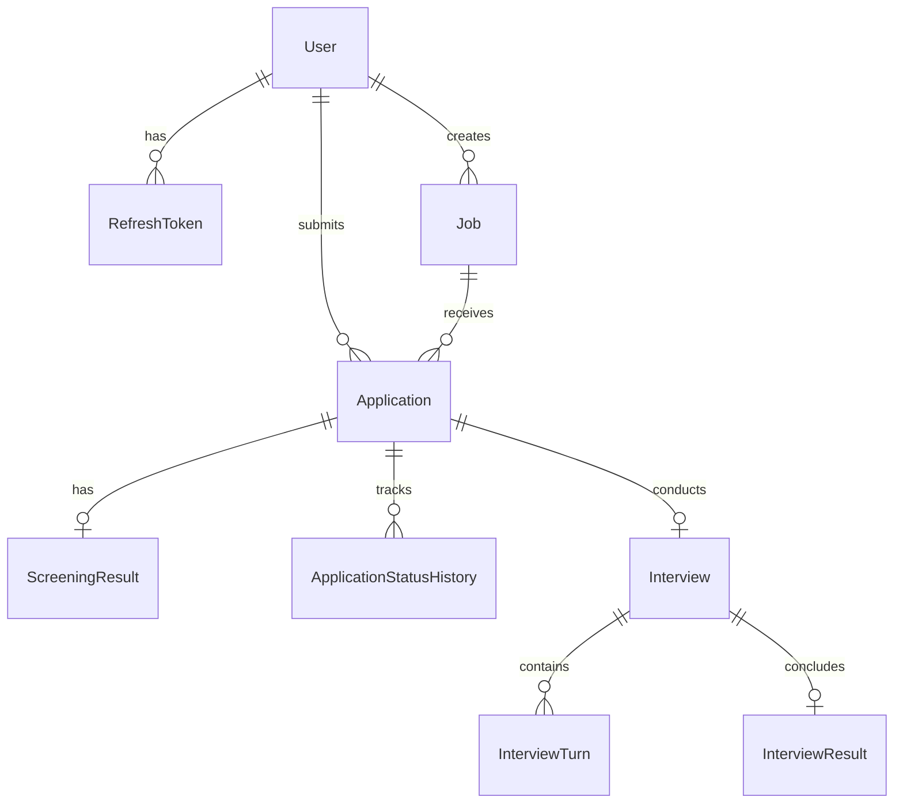

# Data Architecture Spec: Prisma & Domain Model

**Dự án**: Hệ thống Trợ lý Tự động hóa Tuyển dụng & Sơ tuyển Hồ sơ (HireFlow)  
**Tài liệu tham chiếu**: `[W1-BE-01]`, `[W1-AI-01]`, `[W2-BE-03]`  
**Phiên bản**: 1.0.0  
**Trạng thái**: APPROVED SPEC  

---

## 1. Sơ đồ Quan hệ Thực thể (ERD)



---

## 2. Định nghĩa Enums Hệ thống

```prisma
enum Role {
  HR
  CANDIDATE
}

enum ApplicationStatus {
  SUBMITTED           // Vừa nộp CV
  SCREENING           // Đang trong hàng đợi AI chấm
  SCREENING_FAILED    // Lỗi kỹ thuật khi bóc tách / gọi AI
  SCREENED            // AI đã chấm xong
  SHORTLISTED         // Đạt điểm sàn (Được mở khóa phỏng vấn AI)
  REJECTED            // Bị từ chối
  INTERVIEW_INVITED   // Đã gửi email mời phỏng vấn
  INTERVIEWING        // Đang thực hiện phỏng vấn voice
  EVALUATED           // AI đã chấm điểm phỏng vấn xong
  PASSED              // HR duyệt trúng tuyển (Offer)
  FAILED              // Không đạt sau vòng phỏng vấn
}

enum AiRecommendation {
  PASS
  CONSIDER
  REJECT
}

enum AnswerSource {
  VOICE
  TEXT
}
```

---

## 3. Chi tiết Prisma Schema Chuẩn hóa

```prisma
datasource db {
  provider   = "postgresql"
  url        = env("DATABASE_URL")
  extensions = [pgvector(map: "vector")]
}

generator client {
  provider        = "prisma-client-js"
  previewFeatures = ["postgresqlExtensions"]
}

model User {
  id           String         @id @default(uuid())
  email        String         @unique
  passwordHash String
  fullName     String
  role         Role           @default(CANDIDATE)
  createdAt    DateTime       @default(now())
  updatedAt    DateTime       @updatedAt

  createdJobs   Job[]         @relation("CreatedJobs")
  applications  Application[] @relation("CandidateApplications")
  refreshTokens RefreshToken[]

  @@map("users")
}

model RefreshToken {
  id         String    @id @default(uuid())
  userId     String
  tokenHash  String    @unique
  expiresAt  DateTime
  revokedAt  DateTime?
  userAgent  String?
  createdAt  DateTime  @default(now())

  user User @relation(fields: [userId], references: [id], onDelete: Cascade)

  @@index([userId])
  @@map("refresh_tokens")
}

model Job {
  id                     String   @id @default(uuid())
  title                  String
  department             String?
  descriptionRaw         String   @db.Text
  parsedJd               Json?    // Cấu trúc trích xuất từ W1-AI-04: kỹ năng bắt buộc, ưu tiên, số năm KN
  cvPassThreshold        Int      @default(70) // Ngưỡng điểm vào vòng phỏng vấn
  interviewQuestionCount Int      @default(3)  // Số câu hỏi AI phỏng vấn
  rubricWeights          Json?    // Trọng số 4 tiêu chí rubric
  embedding              Unsupported("vector(768)")?
  isActive               Boolean  @default(true)
  createdById            String
  createdAt              DateTime @default(now())
  updatedAt              DateTime @updatedAt

  createdBy    User          @relation("CreatedJobs", fields: [createdById], references: [id])
  applications Application[]

  @@index([createdById])
  @@index([isActive])
  @@map("jobs")
}

model Application {
  id               String            @id @default(uuid())
  jobId            String
  candidateId      String
  cvUrl            String            // Link file PDF trên AWS S3
  cvS3Key          String            // AWS S3 Object Key (ví dụ: resumes/{applicationId}.pdf)
  cvText           String?           @db.Text // Text trích xuất từ unpdf
  parsedCv         Json?             // JSON cấu trúc từ W1-AI-03
  status           ApplicationStatus @default(SUBMITTED)
  screeningError   String?
  aiRecommendation AiRecommendation?
  hrDecisionBy     String?
  hrDecisionAt     DateTime?
  hrNote           String?
  embedding        Unsupported("vector(768)")?
  createdAt        DateTime          @default(now())
  updatedAt        DateTime          @updatedAt

  job             Job                        @relation(fields: [jobId], references: [id], onDelete: Cascade)
  candidate       User                       @relation("CandidateApplications", fields: [candidateId], references: [id], onDelete: Cascade)
  screeningResult ScreeningResult?
  statusHistory   ApplicationStatusHistory[]
  interview       Interview?

  @@unique([jobId, candidateId], name: "unique_application_per_job")
  @@index([jobId])
  @@index([candidateId])
  @@index([status])
  @@map("applications")
}

model ScreeningResult {
  id                   String   @id @default(uuid())
  applicationId        String   @unique
  totalScore           Float    // Điểm 0 - 100
  codeScore            Float    // 40%
  geminiScore          Float    // 40%
  similarityScore      Float    // 20%
  strengths            Json     // Mảng các điểm mạnh
  missingSkills        Json     // Mảng các kỹ năng còn thiếu
  verifiedQuotes       Json     // Trích dẫn chứng thực từ CV
  processingDurationMs Int
  createdAt            DateTime @default(now())

  application Application @relation(fields: [applicationId], references: [id], onDelete: Cascade)

  @@map("screening_results")
}

model ApplicationStatusHistory {
  id            String            @id @default(uuid())
  applicationId String
  fromStatus    ApplicationStatus
  toStatus      ApplicationStatus
  changedBy     String?           // User ID hoặc 'SYSTEM_AI'
  reason        String?
  changedAt     DateTime          @default(now())

  application Application @relation(fields: [applicationId], references: [id], onDelete: Cascade)

  @@index([applicationId])
  @@map("application_status_history")
}

model Interview {
  id                 String    @id @default(uuid())
  applicationId      String    @unique
  recordingConsentAt DateTime?
  startedAt          DateTime?
  completedAt        DateTime?
  transcriptUrl      String?   // File transcript trên AWS S3
  evaluationError    String?
  createdAt          DateTime  @default(now())

  application Application      @relation(fields: [applicationId], references: [id], onDelete: Cascade)
  turns       InterviewTurn[]
  result      InterviewResult?

  @@map("interviews")
}

model InterviewTurn {
  id               String       @id @default(uuid())
  interviewId      String
  orderIndex       Int          // Thứ tự câu hỏi 1, 2, 3...
  question         String       @db.Text
  questionType     String?
  targetSkill      String?
  answerText       String?      @db.Text
  source           AnswerSource @default(VOICE)
  transcriptEdited Boolean      @default(false)
  audioUrl         String?      // Audio WAV 16kHz lưu trên AWS S3
  answeredAt       DateTime?

  interview Interview @relation(fields: [interviewId], references: [id], onDelete: Cascade)

  @@index([interviewId, orderIndex])
  @@map("interview_turns")
}

model InterviewResult {
  id                String            @id @default(uuid())
  interviewId       String            @unique
  technicalScore    Float             // Điểm chuyên môn
  communicationScore Float            // Điểm giao tiếp
  relevanceScore    Float             // Điểm mức độ phù hợp
  evidenceScore     Float             // Điểm bằng chứng
  totalScore        Float             // Điểm tổng rubric
  feedbackSummary   String            @db.Text
  evidenceQuotes    Json              // Dẫn chứng từ transcript
  aiRecommendation  AiRecommendation
  candidateFeedback String            @db.Text // Gửi email phản hồi cho ứng viên
  decisionBy        String?           // HR ID
  decisionAt        DateTime?
  decisionNote      String?
  createdAt         DateTime          @default(now())

  interview Interview @relation(fields: [interviewId], references: [id], onDelete: Cascade)

  @@map("interview_results")
}
```

