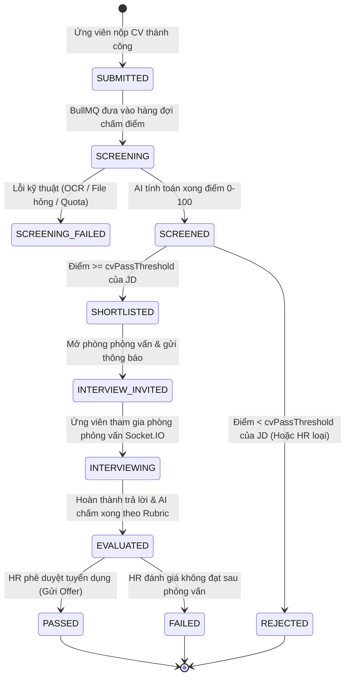

# Product Constitution: Mission & Scope

**Tên dự án**: Hệ thống Trợ lý Tự động hóa Tuyển dụng & Sơ tuyển Hồ sơ  
*(AI Resume Screener & Candidate Evaluator - Codename: HireFlow)*  
**Phiên bản tài liệu**: 2.2.0 (Đã thẩm định kiến trúc & rà soát toàn diện)  
**Trạng thái**: APPROVED CONSTITUTION  
**Đội ngũ thực hiện**: 4 thành viên (Huy - Leader/Monorepo, TV1 - Frontend, TV2 - Backend, TV3 - AI & Pipeline)  
**Thời gian thực hiện**: 03 tuần (Week 1 - Week 3)  

---

## 1. Sứ mệnh sản phẩm & Vấn đề thực tế (Product Mission)

### 1.1 Vấn đề thực tế
- **HR tốn nhiều thời gian**: Trung bình 3–5 phút cho mỗi CV, phần lớn bị lãng phí vào các hồ sơ lệch ngành, thiếu kỹ năng cốt lõi.
- **Ứng viên bị ghosting**: Bị loại không rõ lý do, không nhận được phản hồi mang tính xây dựng về năng lực và khoảng trống kỹ năng (Skill Gap).
- **Vòng sơ tuyển (Phone Screen) thiếu nhất quán**: Phỏng vấn sơ tuyển lặp đi lặp lại những câu hỏi cơ bản, khó đo lường khách quan và phụ thuộc vào cảm tính của người phỏng vấn.

### 1.2 Sứ mệnh giải pháp
Xây dựng nền tảng hỗ trợ tuyển dụng thông minh khép kín:
1. **Sàng lọc tự động & Khách quan**: Trích xuất text từ CV PDF (`unpdf`), tính điểm 0–100 kết hợp 3 thành phần (Code so khớp quy tắc + Gemini Semantic Reasoning + Gemini Vector Embedding Cosine Similarity).
2. **Minh bạch & Tránh Hallucination**: Mọi nhận xét, điểm mạnh, điểm yếu của AI đều phải kèm theo **trích dẫn cụ thể đã kiểm chứng (verified quotes) từ CV**.
3. **Phỏng vấn giọng nói AI đa phương thức**: AI sinh câu hỏi phỏng vấn thích ứng dựa trên lỗ hổng CV so với JD. Hệ thống phát câu hỏi (TTS), ứng viên trả lời bằng giọng nói (MediaRecorder), chuyển đổi WAV qua `ffmpeg`, lưu AWS S3 và **Gemini Multimodal Audio STT** chép lời thoại; chấm điểm theo Rubric 4 tiêu chí.
4. **Phản hồi kịp thời & Đa kênh**: Cập nhật trạng thái trực quan trên trang "Hồ sơ của tôi" (Kênh chính) và tự động gửi thông báo qua **AWS SNS / SES** (Kênh mở rộng).

### 1.3 Tiêu chí Đo lường Thành công (Quantifiable KPIs)
1. **Độ chính xác sàng lọc (Screening Accuracy)**: Đạt độ tương đồng $\ge 80\%$ (hoặc Cohen's Kappa $\ge 0.70$) so với nhãn đánh giá độc lập của con người trên tập Test 20 CV (`[W2-AI-04]`).
2. **Độ trễ xử lý (Processing Latency)**:
   - Thời gian trích xuất và chấm điểm CV: P95 $< 30$ giây/CV qua hàng đợi BullMQ.
   - Thời gian xử lý audio câu trả lời phỏng vấn: P95 $< 8$ giây (tính từ lúc upload đến khi có transcript).
3. **Độ ổn định phỏng vấn (Interview Reliability)**: Tỷ lệ hoàn thành trọn vẹn phiên phỏng vấn voice (không bị gián đoạn WebSocket đột ngột) đạt $\ge 95\%$.

---

## 2. Đối tượng người dùng mục tiêu (Target Personas)

| Persona | Vai trò | Trải nghiệm & Điểm chạm | Cơ chế khởi tạo |
| :--- | :--- | :--- | :--- |
| **HR / Nhà tuyển dụng** | - Quản lý đăng tin tuyển dụng (JD), cấu hình trọng số & điểm sàn sơ loại. - Theo dõi dashboard, bảng xếp hạng ứng viên theo điểm. - Xem chi tiết CV, trích dẫn bằng chứng, nghe audio/đọc transcript phỏng vấn. - Ra quyết định Duyệt / Loại / Gửi Offer. | **HR Portal** (`apps/web` - Layout Sidebar + Header, phân quyền role `HR`). | Tài khoản HR đầu tiên được khởi tạo tự động qua script `prisma/seed.ts`. |
| **Ứng viên (Candidate)** | - Xem danh sách việc làm và chi tiết JD. - Nộp hồ sơ CV định dạng PDF. - Theo dõi trạng thái hồ sơ tại trang "Hồ sơ của tôi". - Tham gia phòng phỏng vấn giọng nói với AI. - Xem kết quả và nhận báo cáo phản hồi kỹ năng. | **Candidate Portal** (`apps/web` - Header + Footer, phân quyền role `CANDIDATE`). | Đăng ký trực tiếp qua màn hình Register trên giao diện Web. |

---

## 3. Phạm vi tính năng (In-Scope vs. Out-of-Scope)

### 3.1 Trong phạm vi (In-Scope - Bắt buộc & Nên có)
- [x] **Monorepo & Kiến trúc**: Quản lý bằng `npm workspaces` (`apps/web`, `apps/api`, `packages/ai`).
- [x] **Xác thực & Phân quyền**: Đăng ký, đăng nhập JWT, tự động refresh token, bảo vệ Route trên FE & Guard trên BE (`HR`, `CANDIDATE`).
- [x] **Quản lý JD**: CRUD tin tuyển dụng, cấu hình tiêu chí (kỹ năng bắt buộc, kỹ năng ưu tiên, số năm kinh nghiệm, ngưỡng điểm sàng lọc).
- [x] **Nộp CV & Lưu trữ**: Upload CV PDF qua Multer, kiểm tra bảo mật, bóc tách text ngay bằng `unpdf`, lưu trữ an toàn trên **AWS S3 Bucket (Private)**.
- [x] **Pipeline Sàng lọc CV**:
  - Hàng đợi chạy nền (BullMQ + Redis) tự động chấm khi có CV mới, có cơ chế retry và phục hồi sau sự cố.
  - Chấm điểm 0–100 kết hợp 3 lớp: Code Rule-based (40%) + Gemini Semantic (40%) + Embedding 768 chiều (20%).
  - Trích xuất điểm mạnh, kỹ năng còn thiếu kèm trích dẫn văn bản gốc từ CV.
- [x] **Phòng phỏng vấn AI Voice (Realtime)**:
  - Sinh bộ 3–5 câu hỏi thích ứng (dựa trên JD + CV + kỹ năng còn thiếu) một lần khi bắt đầu phiên.
  - Giao tiếp realtime qua WebSocket (**Socket.IO** có WsJwtGuard bảo vệ).
  - Web phát âm câu hỏi qua SpeechSynthesis (TTS); ứng viên thu âm câu trả lời bằng MediaRecorder $\rightarrow$ gửi API chuyển sang WAV 16kHz (`ffmpeg`) $\rightarrow$ lưu AWS S3 $\rightarrow$ **Gemini Multimodal Audio STT** chép lời thoại.
  - Chấm điểm phỏng vấn theo Rubric 4 tiêu chí (Chuyên môn, Giao tiếp, Mức độ phù hợp, Bằng chứng thực tế).
- [x] **Thông báo & Phản hồi**:
  - Kênh chính (Bắt buộc): Màn hình "Hồ sơ của tôi" hiển thị trực tiếp trạng thái, điểm số và nhận xét.
  - Kênh mở rộng (Nên có): Gửi thông báo/email qua **AWS SNS / SES** (mời phỏng vấn, email phân tích khoảng trống kỹ năng khi trượt).
- [x] **Benchmark & Đánh giá**: Bộ dữ liệu chuẩn gồm 30 CV giả + 3 JD, 2 người gán nhãn độc lập, đo lường độ chính xác trên tập Dev / Test.
- [x] **Đóng gói & Triển khai**: Docker Compose (NestJS có cài đặt binary `ffmpeg`, PostgreSQL + pgvector, Redis), Caddy reverse proxy, deploy lên AWS EC2.

### 3.2 Ngoài phạm vi (Out-of-Scope - Không làm trong đồ án)
- [ ] Ghi hình video hoặc phân tích khuôn mặt/cảm xúc (Face/Emotion AI).
- [ ] Tích hợp lịch bên thứ 3 (Google Calendar / Outlook Calendar).
- [ ] Cổng thanh toán, gói cước và mô hình Multi-tenant SaaS cho nhiều công ty khác nhau.
- [ ] Màn hình Quản trị viên Super Admin phức tạp (quản lý qua DB/Seed script).

---

## 4. Vòng đời dữ liệu đơn ứng tuyển (State Machine Chuẩn hóa)

State Machine được quản lý tập trung trên Backend (`[W2-BE-03]`), đồng bộ 100% với Enum `ApplicationStatus` trong Database Prisma:

---

## 5. Phân công vai trò & Trách nhiệm (RACI Matrix)

| Thành viên | Ký hiệu | Trách nhiệm chính theo Trello |
| :--- | :--- | :--- |
| **Huy (Leader)** | **LEAD** | Khởi tạo Monorepo (`W1-00`), chuẩn hóa quy chuẩn code, điều phối tiến độ & review PR. |
| **Thành viên 1** | **TV1 (Frontend)** | Toàn bộ giao diện React/Vite/Tailwind: Auth, HR Portal, Candidate Portal, Phòng phỏng vấn voice, Caddy server. |
| **Thành viên 2** | **TV2 (Backend)** | Toàn bộ NestJS API, Prisma schema, PostgreSQL + pgvector, BullMQ/Queue, Socket.IO Gateway, AWS S3, AWS SNS/SES, Docker EC2. |
| **Thành viên 3** | **TV3 (AI & Data)** | Package `@hireflow/ai`, Prompt Engineering Zod, unpdf, Gemini STT/Embedding, thuật toán chấm điểm, bộ test 30 CV/3 JD. |
