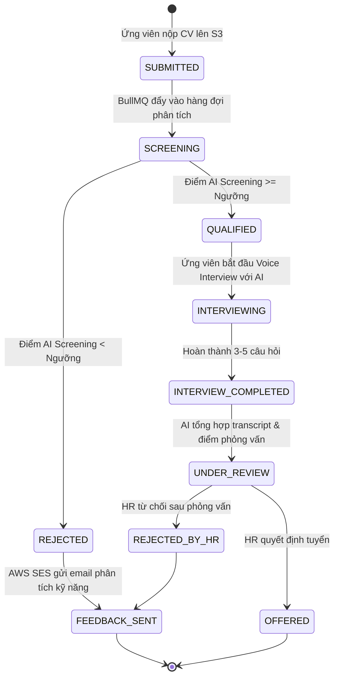

# Product Constitution: Mission & Scope

**Project Name**: Hệ thống Trợ lý Tự động hóa Tuyển dụng & Sơ tuyển Hồ sơ  
*(AI Resume Screener & Candidate Evaluator)*  
**Document Version**: 1.0.0  
**Status**: APPROVED BASELINE  
**Authoring Team**: 4 engineers (1 BE Lead, 1 BE + AI, 2 FE)  
**Execution Window**: 02 - 04 weeks  

---

## 1. Product Mission & Problem Statement

### 1.1 Vấn đề thực tế (The Problem)
Trong quy trình tuyển dụng truyền thống:
- HR mất quá nhiều thời gian (trung bình 3–5 phút/CV) để đọc lướt hồ sơ không phù hợp.
- Ứng viên nộp hồ sơ thường rơi vào "hố đen tuyển dụng" (ghosting) — bị loại mà không rõ lý do hoặc điểm yếu kỹ năng cần cải thiện.
- Vòng sơ tuyển (Phone Screen) thường tốn kém thời gian của cả HR lẫn ứng viên cho những câu hỏi cơ bản lặp đi lặp lại.

### 1.2 Sứ mệnh sản phẩm (Product Mission)
Xây dựng một hệ thống tự động hóa khép kín quy trình sơ tuyển ứng viên bằng AI:
1. **Tiết kiệm 80% thời gian sơ loại** của HR thông qua việc trích xuất, đối soát ngữ nghĩa giữa CV và JD bằng Vector Search kết hợp LLM Reasoning.
2. **Tự động hóa vòng phỏng vấn sơ loại (Phone Screen)** bằng AI tương tác giọng nói thời gian thực.
3. **Minh bạch và tôn trọng ứng viên**: Cung cấp báo cáo phân tích kỹ năng và điểm cần khắc phục cho ứng viên bị từ chối.

---

## 2. Đối tượng người dùng mục tiêu (Target Personas)

| Persona                  | Vai trò & Mục tiêu                                                                                                                                                                         | Điểm chạm (Touchpoints)                                  |
|:-------------------------|:-------------------------------------------------------------------------------------------------------------------------------------------------------------------------------------------|:---------------------------------------------------------|
| **HR / Nhà tuyển dụng**  | - Đăng tin tuyển dụng (JD) kèm tiêu chí trọng số. - Cấu hình điểm sàn sơ loại. - Xem bảng xếp hạng ứng viên và báo cáo đánh giá AI. - Đưa ra quyết định Offer / Reject cuối cùng. | Web Dashboard quản trị (Yêu cầu đăng nhập tài khoản HR). |
| **Ứng viên (Candidate)** | - Xem chi tiết JD. - Tạo tài khoản và nộp hồ sơ CV (PDF). - Tham gia phỏng vấn giọng nói với AI nếu đạt điểm sàn. - Nhận phản hồi chi tiết về kỹ năng nếu không đạt.              | Candidate Portal (Yêu cầu đăng nhập tài khoản Ứng viên). |

---

## 3. Phạm vi tính năng (In-Scope vs. Out-of-Scope)

### 3.1 Trong phạm vi (In-Scope for MVP 2–4 tuần)
- [x] **Xác thực & Phân quyền (RBAC)**: Đăng ký/Đăng nhập bằng JWT cho cả `HR` và `CANDIDATE`.
- [x] **Quản lý Job/JD**: HR tạo, sửa, đóng tin tuyển dụng; cấu hình ngưỡng điểm phỏng vấn (`passScoreThreshold`, mặc định ví dụ $\ge 70$).
- [x] **Ứng tuyển & Lưu trữ CV**: Ứng viên nộp CV định dạng PDF; file được lưu trữ an toàn trên **AWS S3**.
- [x] **AI Screening & Ranking Pipeline**:
  - Trích xuất nội dung text từ PDF bằng `unpdf`.
  - Sinh vector embedding (Gemini Embedding) và đánh giá độ phù hợp (Gemini Flash) theo Zod Schema chuẩn hóa.
  - Xếp hạng ứng viên và hiển thị phân tích điểm mạnh / điểm yếu.
- [x] **AI Voice Interview sơ loại**:
  - Tự động mở khóa phòng phỏng vấn khi điểm sàng lọc đạt ngưỡng.
  - Phỏng vấn 3–5 câu hỏi thích ứng (adaptive) dựa trên lỗ hổng trong CV của ứng viên so với JD.
  - Giao tiếp giọng nói hai chiều qua **Web Speech API** (STT & TTS trên trình duyệt) kết nối thời gian thực qua **Socket.IO**.
- [x] **Báo cáo & Phản hồi**:
  - Báo cáo tổng hợp buổi phỏng vấn cho HR ra quyết định.
  - Tự động gửi email thông báo kết quả và phản hồi kỹ năng (Skill Gap Analysis) qua **AWS SES/SNS Sandbox**.
- [x] **Triển khai**: Đóng gói hoàn chỉnh bằng **Docker Compose** chạy trên VPS.

### 3.2 Ngoài phạm vi (Out-of-Scope - Hoãn lại sau MVP)
- [ ] Ghi hình video hoặc phân tích khuôn mặt / cảm xúc (Face / Emotion Detection).
- [ ] Tích hợp lịch phỏng vấn bên thứ ba (Google Calendar, Outlook Calendar).
- [ ] Cổng thanh toán (Billing / Subscription) và kiến trúc đa doanh nghiệp (Multi-tenant SaaS).
- [ ] Hỗ trợ đa ngôn ngữ phức tạp (tập trung tối ưu trước mắt cho Tiếng Việt / Tiếng Anh chuẩn).

---

## 4. Vòng đời dữ liệu đơn ứng tuyển (Application State Machine)

---

## 5. Bảng kiểm chứng (Facts vs. Non-Negotiable Decisions)

- **Đã kiểm chứng (Verified Fact)**: Team gồm 4 thành viên (1 BE, 1 BE+AI, 2 FE), thời hạn 2–4 tuần.
- **Quyết định bất biến (Non-Negotiable Decisions)**:
  - Cả HR và Ứng viên đều phải đăng nhập qua JWT.
  - Lưu file CV trực tiếp lên AWS S3.
  - Phỏng vấn Voice dùng Web Speech API ở Client để tối ưu thời gian phát triển và chi phí hạ tầng.
  - Sử dụng BullMQ + Redis để xử lý bất đồng bộ các tác vụ nặng (Parse PDF, Call Gemini).
  - Triển khai toàn bộ hệ thống bằng Docker Compose trên VPS.

