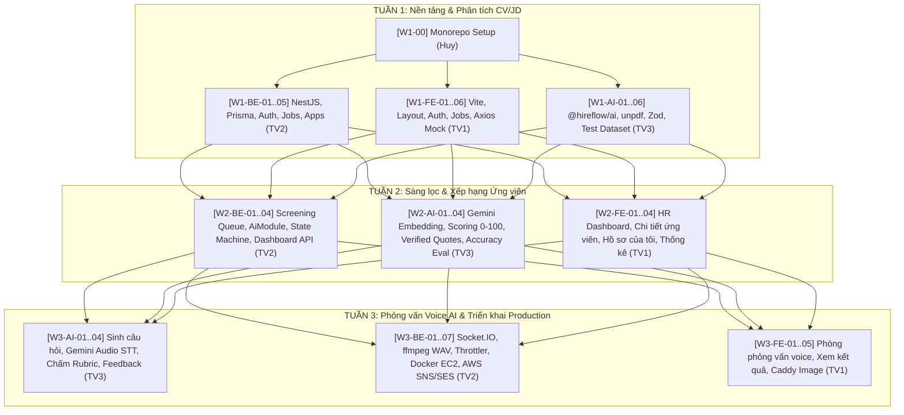

# Product Constitution: Milestones & Detailed Roadmap

**Tên dự án**: Hệ thống Trợ lý Tự động hóa Tuyển dụng & Sơ tuyển Hồ sơ (HireFlow)  
**Phiên bản tài liệu**: 2.2.0 (Đã thẩm định kiến trúc & phân rã các tính năng lớn)  
**Thời gian thực hiện**: 03 tuần (Week 1 – Week 3)  
**Phân công nhân sự**:
- **Huy (Lead)**: Quản trị Monorepo, review quy chuẩn code & điều phối tổng thể.
- **TV1 (Frontend)**: Toàn bộ giao diện React, Vite, shadcn/ui, TanStack Query, Web Speech & Caddy server.
- **TV2 (Backend)**: NestJS API, Prisma, PostgreSQL + pgvector, Queue, Socket.IO, AWS S3, AWS SNS/SES, Docker EC2.
- **TV3 (AI & Pipeline)**: Package `@hireflow/ai`, Prompting Zod, unpdf, Gemini STT/Embedding, thuật toán chấm điểm, bộ test 30 CV.

---

## 1. Sơ đồ Tiến độ 3 Tuần

---

## 2. Chi tiết phân rã Task theo từng tuần (Đã tối ưu để Review an toàn)

### TUẦN 1: Nền tảng & Phân tích CV/JD (17 Tasks)

#### Nền tảng chung
- [x] **`[W1-00]` Khởi tạo monorepo npm**: `apps/web`, `apps/api`, `packages/ai` *(Huy - Bắt buộc)*.
- [ ] **Quy ước mức độ ưu tiên**: Phổ biến nguyên tắc Bắt buộc > Nên có > Có thể có *(Cả team)*.

#### Backend (TV2)
- [ ] **`[W1-BE-01]` Cấu hình apps/api: Prisma & PostgreSQL + pgvector** *(Bắt buộc)*:
  - *PR 1.1 (Core Models)*: Docker Postgres + pgvector, Prisma init, Model User, RefreshToken, Job, Seed admin ban đầu.
  - *PR 1.2 (Recruitment Models)*: Model Application, ScreeningResult, ApplicationStatusHistory, Interview, InterviewTurn, InterviewResult, cột vector(768).
- [ ] **`[W1-BE-02]` API contract**: Format response chuẩn, DTO + class-validator, cấu hình Swagger cho Auth, Jobs, Applications *(Bắt buộc)*.
- [ ] **`[W1-BE-03]` Module Auth**: Đăng ký, đăng nhập JWT, Guard toàn cục, `@Public()`, `@Roles()`, `@CurrentUser()` *(Bắt buộc)*.
- [ ] **`[W1-BE-04]` Module Jobs**: CRUD tin tuyển dụng, cấu hình tiêu chí sàng lọc và ngưỡng điểm phỏng vấn, kiểm tra quyền sở hữu HR *(Bắt buộc)*.
- [ ] **`[W1-BE-05]` Module Applications**: Nộp CV bằng Multer, kiểm tra tệp PDF, trích text ngay khi nộp bằng `unpdf`, lưu trữ tệp lên **AWS S3 Bucket Private** *(Bắt buộc)*.

#### Frontend (TV1)
- [ ] **`[W1-FE-01]` Cấu hình apps/web**: Cài đặt Tailwind CSS, shadcn/ui, React Router, path alias, biến môi trường `.env` *(Bắt buộc)*.
- [ ] **`[W1-FE-02]` Layout chung**: Bố cục HR (Sidebar + Header), bố cục Ứng viên (Header + Footer), phân luồng route theo role *(Bắt buộc)*.
- [ ] **`[W1-FE-03]` Màn hình Auth**: Đăng ký, đăng nhập, lưu trữ token, khôi phục phiên và `ProtectedRoute` *(Bắt buộc)*.
- [ ] **`[W1-FE-04]` Màn hình HR - Jobs**: Danh sách tin tuyển dụng, form tạo/sửa tin kèm cấu hình tiêu chí sàng lọc *(Bắt buộc)*.
- [ ] **`[W1-FE-05]` Màn hình Ứng viên - Jobs**: Danh sách việc làm, trang xem chi tiết JD, form nộp CV PDF có progress bar và báo lỗi *(Bắt buộc)*.
- [ ] **`[W1-FE-06]` Tầng gọi API**: Cấu hình Axios client, tự động refresh token, TanStack Query, proxy Vite mock API qua Apidog *(Bắt buộc)*.

#### AI & Pipeline (TV3)
- [ ] **`[W1-AI-01]` Cấu hình packages/ai**: Build bằng `tsdown` để NestJS import `@hireflow/ai`, Gemini client, retry, timeout, logging, hàm sinh JSON có cấu trúc *(Bắt buộc)*.
- [ ] **`[W1-AI-02]` Trích xuất văn bản CV PDF bằng unpdf**: Chuẩn hóa tiếng Việt, phát hiện file ảnh scan, bọc thẻ XML `<candidate_cv>` phòng ngừa Prompt Injection *(Bắt buộc)*.
- [ ] **`[W1-AI-03]` Parse CV ra JSON có cấu trúc**: Sử dụng Zod + `generateStructured`, trích xuất thông tin, chuẩn hóa kỹ năng, tính số năm kinh nghiệm *(Bắt buộc)*.
- [ ] **`[W1-AI-04]` Trích yêu cầu từ JD ra JSON**: Gộp kỹ năng HR nhập và kỹ năng trong mô tả, chuẩn hóa từ vựng đồng nhất với CV *(Bắt buộc)*.
- [ ] **`[W1-AI-06]` Xây dựng bộ dữ liệu benchmark**: 30 CV giả lập + 3 JD, 2 người gán nhãn độc lập (double-blind), tách tập Dev (1/3) và Test (2/3) lưu tại `packages/fixtures` *(Bắt buộc)*.

---

### TUẦN 2: Sàng lọc & Xếp hạng Ứng viên (12 Tasks)

#### Backend (TV2)
- [ ] **`[W2-BE-01]` Pipeline chấm CV chạy nền**: BullMQ xử lý tự động sau khi nộp CV, cơ chế thử lại (retry), hỗ trợ chấm lại, khôi phục job khi restart server *(Bắt buộc)*.
- [ ] **`[W2-BE-02]` Tích hợp @hireflow/ai vào NestJS**: Xây dựng `AiModule`, hàng đợi AI dùng chung, phân tích JD khi tạo và lưu kết quả chấm CV vào DB *(Bắt buộc)*.
- [ ] **`[W2-BE-03]` State Machine trạng thái hồ sơ**: Quản lý chuyển trạng thái tập trung (`SUBMITTED` $\rightarrow$ `SCREENING` $\rightarrow$ `SCREENED` $\rightarrow$ `SHORTLISTED` / `REJECTED`), lưu lịch sử biến động, phát sự kiện *(Bắt buộc)*.
- [ ] **`[W2-BE-04]` API Dashboard HR**: Lấy danh sách ứng viên theo Job, xem chi tiết đánh giá, API duyệt/loại, Pre-signed URL xem CV AWS S3, số liệu thống kê *(Bắt buộc)*.

#### AI & Pipeline (TV3)
- [ ] **`[W2-AI-01]` Embedding CV và JD**: Sử dụng Gemini Embedding (768 chiều), tạo văn bản tóm tắt có cấu trúc, tính cosine similarity *(Bắt buộc)*.
- [ ] **`[W2-AI-02]` & `[W2-AI-03]` Thuật toán chấm điểm CV 0–100 & Trích dẫn bằng chứng** *(Bắt buộc)*:
  - *Sub-task 1*: Module tính điểm Rule-based (kỹ năng, kinh nghiệm) + Cosine similarity (20%).
  - *Sub-task 2*: Prompt Gemini chấm ngữ nghĩa sâu + trích xuất Verified Quotes nguyên văn từ CV; đóng gói hàm tổng `screenCv()` cho BE gọi.
- [ ] **`[W2-AI-04]` Đánh giá độ chính xác sàng lọc**: Tối ưu ngưỡng điểm trên tập Dev, đánh giá và báo cáo độ chính xác (mục tiêu $\ge 80\%$) trên tập Test; thêm script `npm run test:ai-eval` *(Bắt buộc)*.

#### Frontend (TV1)
- [ ] **`[W2-FE-01]` Dashboard HR**: Danh sách ứng viên theo từng Job, hiển thị điểm số, đề xuất AI, bộ lọc theo trạng thái, sắp xếp và nút chấm lại *(Bắt buộc)*.
- [ ] **`[W2-FE-02]` Màn hình Chi tiết Ứng viên (HR)**: Hiển thị bảng điểm chi tiết, điểm mạnh, kỹ năng còn thiếu, trích dẫn đối soát CV, đề xuất AI, nút bấm Duyệt / Loại *(Bắt buộc)*.
- [ ] **`[W2-FE-03]` Màn hình "Hồ sơ của tôi" (Ứng viên)**: Hiển thị trạng thái hồ sơ thân thiện, mở khóa nút "Vào phỏng vấn AI" khi đơn chuyển sang `SHORTLISTED` *(Bắt buộc)*.
- [ ] **`[W2-FE-04]` Thống kê Dashboard HR**: Biểu đồ hồ sơ theo trạng thái, biểu đồ phân bố điểm số, tỷ lệ AI đề xuất đạt *(Nên có)*.

---

### TUẦN 3: Phỏng vấn Giọng nói AI & Triển khai Production (17 Tasks)

#### AI & Phỏng vấn Đa phương thức (TV3)
- [ ] **`[W3-AI-01]` Sinh bộ câu hỏi phỏng vấn**: Tạo 3–5 câu hỏi thích ứng dựa trên JD + CV + khoảng trống kỹ năng một lần khi bắt đầu phiên *(Bắt buộc)*.
- [ ] **`[W3-AI-04]` Chuyển giọng nói thành văn bản (STT) bằng Gemini**: Đọc file audio WAV từ backend/S3, chép nguyên văn lời nói, phát hiện trường hợp im lặng *(Bắt buộc)*.
- [ ] **`[W3-AI-02]` Chấm điểm phỏng vấn theo Rubric**: Đánh giá 4 tiêu chí (Chuyên môn, Giao tiếp, Mức độ phù hợp, Bằng chứng thực tế) *(Bắt buộc)*.
- [ ] **`[W3-AI-03]` Báo cáo & Phản hồi kỹ năng**: Sinh nhận xét chi tiết cho ứng viên, đóng gói hàm tổng `evaluateInterview()` cho BE *(Bắt buộc)*.

#### Backend & Triển khai (TV2)
- [ ] **`[W3-BE-01]` InterviewGateway (Socket.IO)**: Quản lý vòng đời phòng phỏng vấn (`join`, `start`, `submit_answer`, `reconnect`, `end`), tích hợp `WsJwtGuard` xác thực token và quyền sở hữu đơn ứng tuyển *(Bắt buộc)*.
- [ ] **`[W3-BE-02]` Xử lý Audio câu trả lời** *(Bắt buộc)*:
  - *Sub-task 1*: Nhận audio blob từ client, dùng `fluent-ffmpeg` chuyển sang WAV 16kHz Mono, upload lên AWS S3.
  - *Sub-task 2*: Gọi `W3-AI-04` (Gemini STT) lấy transcript và trả về cho client.
- [ ] **`[W3-BE-03]` Xử lý đánh giá phỏng vấn ngầm**: Lưu transcript, tính điểm rubric, API xem kết quả phỏng vấn, cập nhật quyết định Đạt (`PASSED`) / Không đạt (`FAILED`) *(Bắt buộc)*.
- [ ] **`[W3-BE-04]` Throttling & Rate-limiting**: Tích hợp `@nestjs/throttler` bảo vệ quota của Gemini API *(Bắt buộc)*.
- [ ] **`[W3-BE-05]` Đóng gói Docker & Triển khai EC2**: Viết Dockerfile cài đặt binary `ffmpeg`, docker-compose (API + DB + Redis), cấu hình CI/CD GitHub Actions *(Bắt buộc)*.
- [ ] **`[W3-BE-07]` Gửi Thông báo bằng AWS SNS / SES**: Gửi email mời phỏng vấn, email thông báo kết quả kèm bảng phân tích kỹ năng *(Nên có - Fallback: hiển thị trên web)*.
- [ ] **`[W3-BE-06]` Tài liệu & Dữ liệu Demo**: Hoàn thiện README, sơ đồ kiến trúc, dữ liệu seed demo, kịch bản chạy thử toàn bộ luồng *(Bắt buộc)*.

#### Frontend (TV1)
- [ ] **`[W3-FE-01]` Phòng phỏng vấn - Chế độ chữ**: Giới thiệu, đồng ý ghi âm, kiểm tra microphone, tương tác hỏi đáp theo lượt, xử lý tự động kết nối lại *(Bắt buộc)*.
- [ ] **`[W3-FE-02]` Phòng phỏng vấn - Chế độ giọng nói**: Đọc câu hỏi (TTS), thu âm câu trả lời (MediaRecorder), xem lại và sửa transcript trước khi xác nhận gửi *(Bắt buộc)*.
- [ ] **`[W3-FE-03]` HR xem kết quả phỏng vấn**: Xem toàn bộ đoạn hội thoại transcript, điểm theo từng tiêu chí rubric, bằng chứng trích dẫn, nút Đạt / Không đạt *(Bắt buộc)*.
- [ ] **`[W3-FE-04]` Ứng viên xem kết quả & Phản hồi**: Trang hiển thị kết quả phỏng vấn và báo cáo chi tiết kỹ năng cần cải thiện *(Bắt buộc)*.
- [ ] **`[W3-FE-05]` Đóng gói Image Web với Caddy**: Build tĩnh SPA, cấu hình Caddy tự động cấp SSL/HTTPS, reverse proxy `/api` và `/socket.io`, tối ưu responsive *(Bắt buộc)*.
