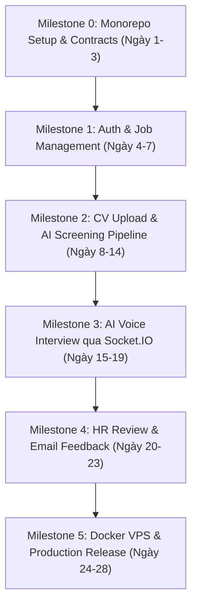

# Product Constitution: Milestones & Roadmap

**Project Name**: Hệ thống Trợ lý Tự động hóa Tuyển dụng & Sơ tuyển Hồ sơ  
**Timeline**: 02 - 04 tuần (28 ngày làm việc)  
**Team Allocation**:
- **BE Lead**: Kiến trúc, Auth, Prisma, Queue, S3 Presigned URL, AWS SES.
- **BE + AI**: Gemini integration, Vector search (pgvector), Prompting, Socket.IO Gateway.
- **FE 1**: Candidate Portal (Xem JD, Nộp CV, Giao diện Voice Interview).
- **FE 2**: HR Portal (Dashboard, Quản lý JD, Bảng xếp hạng ứng viên, Báo cáo phỏng vấn).

---

## 1. Bản đồ lộ trình tổng quan (Gantt Overview)

---

## 2. Chi tiết các cột mốc (Milestones & Deliverables)

### Milestone 0: Nền tảng Monorepo & Đặc tả Hợp đồng (Ngày 1 – 3)
*Mục tiêu: Cả team có khung làm việc chung, FE có thể mock API ngay lập tức.*
- [ ] Khởi tạo Monorepo với `pnpm` + `turborepo`.
- [ ] Cấu hình package `shared`: định nghĩa toàn bộ Types, Enums, Zod Schemas và Socket Events.
- [ ] Tạo file `schema.prisma` đầy đủ các quan hệ thực thể.
- [ ] Cấu hình Swagger/OpenAPI tự động sinh trên NestJS API.
- **Tiêu chí nghiệm thu (DoD)**: Chạy `pnpm build` và `pnpm lint` thành công trên toàn bộ repo; FE import được types từ `@ai-resume/shared`.

---

### Milestone 1: Xác thực & Quản lý Tin Tuyển Dụng (Ngày 4 – 7)
*Mục tiêu: Đăng nhập được hệ thống và HR tạo được JD với tiêu chí điểm sàn.*
- **Backend (BE Lead)**:
  - Auth module: JWT sign/verify, Refresh token, Roles Guard (`HR`, `CANDIDATE`).
  - Job module: CRUD Job, cấu hình `passScoreThreshold` và mảng tiêu chí kỹ năng.
- **Frontend (FE 1 & FE 2)**:
  - Màn hình Đăng nhập / Đăng ký (chung giao diện hoặc tab cho HR/Candidate).
  - HR Dashboard: Form tạo/sửa JD, danh sách các JD đang mở.
  - Candidate Portal: Trang danh sách việc làm và xem chi tiết JD.
- **Tiêu chí nghiệm thu (DoD)**: HR tạo được JD mới; Ứng viên đăng ký tài khoản và xem được chi tiết JD.

---

### Milestone 2: Nộp CV & Pipeline AI Sàng lọc (Ngày 8 – 14)
*Mục tiêu: Ứng viên nộp CV PDF lên S3; BullMQ xử lý trích xuất văn bản, chấm điểm và xếp hạng.*
- **Backend (BE Lead + BE AI)**:
  - API xin AWS S3 Presigned URL cho upload file PDF.
  - BullMQ Queue & Worker: Đọc PDF bằng `unpdf`, gọi Gemini Embedding & Gemini Flash để chấm điểm theo Zod Schema.
  - Lưu kết quả `ScreeningResult` vào database (`matchScore`, `strengths`, `weaknesses`).
- **Frontend (FE 1 & FE 2)**:
  - Candidate: Component upload CV kéo-thả, hiển thị trạng thái xử lý hồ sơ (Processing/Done).
  - HR: Bảng xếp hạng ứng viên (Leaderboard) theo `matchScore`, bộ lọc theo trạng thái.
- **Tiêu chí nghiệm thu (DoD)**: Nộp 1 file CV thật $\rightarrow$ Hệ thống tự động phân tích và hiển thị điểm cùng điểm mạnh/yếu trên màn hình HR.

---

### Milestone 3: Phỏng vấn Giọng nói AI thời gian thực (Ngày 15 – 19)
*Mục tiêu: Ứng viên vượt qua điểm sàn được mở khóa phòng Voice Interview với AI.*
- **Backend (BE AI)**:
  - Socket.IO Gateway quản lý session phỏng vấn (`join_interview`, `candidate_speak`, `ai_response`, `end_interview`).
  - AI Engine sinh 3–5 câu hỏi thích ứng (dựa vào lỗ hổng CV phát hiện ở Milestone 2).
  - Lưu lại toàn bộ transcript và tổng hợp điểm phỏng vấn sau khi kết thúc.
- **Frontend (FE 1)**:
  - Giao diện phòng phỏng vấn voice (hiển thị sóng âm/avatar tương tác, nút bật/tắt mic).
  - Tích hợp Web Speech API (nhận diện giọng nói STT và đọc câu hỏi TTS).
- **Tiêu chí nghiệm thu (DoD)**: Ứng viên hoàn thành một buổi phỏng vấn 3 câu hỏi qua giọng nói; server lưu lại trọn vẹn transcript.

---

### Milestone 4: Đánh giá HR & Gửi Feedback Tự động (Ngày 20 – 23)
*Mục tiêu: HR xem báo cáo tổng hợp và chốt kết quả; ứng viên bị loại nhận email phân tích kỹ năng.*
- **Backend (BE Lead)**:
  - Tích hợp AWS SES / SNS Sandbox để gửi email.
  - Module gửi email template chứa chi tiết `Skill Gap Analysis` cho ứng viên có trạng thái `REJECTED`.
  - API cho HR cập nhật quyết định (`OFFERED` / `REJECTED_BY_HR`).
- **Frontend (FE 2)**:
  - Màn hình chi tiết ứng viên: Xem toàn bộ điểm screening, transcript phỏng vấn voice và đánh giá tổng quan của AI.
  - Nút bấm duyệt Offer / Từ chối.
- **Tiêu chí nghiệm thu (DoD)**: HR bấm Reject ứng viên $\rightarrow$ AWS SES gửi email feedback kỹ năng thực tế đến hộp thư ứng viên trong sandbox.

---

### Milestone 5: Đóng gói Docker & Triển khai VPS (Ngày 24 – 28)
*Mục tiêu: Đưa toàn bộ hệ thống lên môi trường production VPS cá nhân.*
- [ ] Viết `Dockerfile` tối ưu multi-stage build cho `api` và `web`.
- [ ] Thiết lập file `docker-compose.yml` gồm các services: `web-app`, `api-app`, `postgres`, `redis`, `nginx-proxy`.
- [ ] Cấu hình Nginx reverse proxy + SSL tự động qua Certbot trên VPS.
- [ ] Chạy kiểm thử toàn bộ luồng nghiệp vụ trên môi trường VPS thực tế.
- **Tiêu chí nghiệm thu (DoD)**: Toàn bộ hệ thống chạy ổn định qua domain/IP của VPS, phục vụ đồng thời cả HR và Ứng viên.

